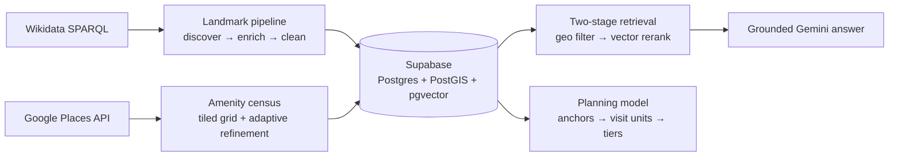

# GoAI (gAIde) — ML engineering

The AI/ML side of **GoAI**, an AI city-exploration guide for foreign visitors, launching in Baku. The app is English-only; this repository owns the data and intelligence layer. The Flutter client and Spring Boot backend were built by teammates and live elsewhere.

**My role:** AI/ML engineer on a small team (Jun – Aug 2026). I built the grounding data pipelines, the retrieval loop, and the itinerary-planning model described below.

## The core idea: grounding, not generation

A travel guide that invents history, atmosphere or opening hours is worse than no guide. Every part of this repo follows one rule: **the model narrates, ranks or serves from verified place data and never invents.** That rule is applied from data acquisition (missing values stay `NULL`, ambiguous rows are flagged instead of dropped) up to the prompts (a landmark with fewer than three real details gets *no* narrative at all).

Two content types have opposite data shapes, so they get opposite treatment:

| | Landmarks | Amenities (cafés, restaurants, leisure) |
|---|---|---|
| Data shape | Sparse, fact-rich | Dense, fact-poor |
| Source | Wikidata (SPARQL) + Wikipedia intro extracts | Google Places API (New) |
| Served as | **Narrated** by Gemini, clamped to verified facts | **Retrieved** with category and distance, never narrated |

## Architecture



### 1. Landmark pipeline
- **Discovery and enrichment are separate queries.** Discovery finds items *contained in* the city (`wdt:P131+`) and filters by notability (sitelinks). Enrichment pins the discovered set with `VALUES` and adds inception, architect, style, heritage status and more in batches of about 150. Pinning the set avoids a second transitive closure and keeps the queries inside Wikidata's timeout.
- Resumable by design: a per-QID checkpoint means a failed batch re-runs only the remainder.
- Roughly 400 candidates became **305 clean landmarks**, each with a Wikipedia intro extract.
- **Existence tracking:** `existence_status` (`ok` / `flagged` / `gone`) catches demolished sites. It is never an automatic drop: Bibi-Heybat Mosque is tagged destroyed in Wikidata (dynamited 1936) but was rebuilt and is open today, so every flag is resolved by hand and recorded.

### 2. Retrieval and grounded answers
- Postgres with PostGIS and pgvector on Supabase. `geography` columns give distances in real metres. Embeddings are `gemini-embedding-001` at 768 dimensions (HNSW index), with a GiST index on location.
- **Two-stage retrieval:** a cheap `ST_DWithin` geo filter first, then a pgvector cosine rerank within the candidates, so a great content match 40 km away never buries a good one around the corner.
- **Grounded generation:** the top results become a context block, and Gemini 2.5 Flash answers clamped to that context and refuses to invent.
- Validated in both directions: *"oldest historic site"* near the Old City ranks Maiden Tower first (semantics beat raw proximity), while the same question near Flag Square is correctly **refused** because the nearby data doesn't support the claim.

### 3. Offline overview generation
`generate_overviews.py` runs one Gemini call per landmark and produces a card summary, a narrative and a retrieval string. It is resumable through an append-only checkpoint, and it works from a strict grounding contract in `prompts.py`: *"Atmosphere is a fact claim. You have never been to this place."*

### 4. Amenities: measuring data quality instead of assuming it
OpenStreetMap was the original amenity source. I hand-validated 50 venues around Icherisheher: about **20% were permanently closed** and about **25% could not be verified**. That justified switching to Google Places, which exposes `businessStatus`, so staleness becomes measurable.

| 50-venue ground truth (Icherisheher) | Google Places | OSM baseline |
|---|---|---|
| 6 permanently closed venues still listed | **0 of 6** | 6 of 6 |
| 22 operational venues, confidently matched | 13 (4 more ambiguous) | n/a (ground truth was sampled from OSM, so it matches by construction) |
| 7 renamed venues, location covered | 7 of 7 | n/a |

Engineering behind the census (`get_amenities_places.py`): a tiled grid, because Nearby Search hard-caps at 20 results with no pagination; **adaptive refinement** that splits any saturated tile until nothing truncates; an append-only checkpoint guarded by a plan fingerprint; and a field mask chosen so the whole run stays in the free billing tier. The result is **6,563 amenities**.

### 5. Itinerary planning model
Landmarks are grouped into **anchors** (walkable clusters with a 700 m radius) and, within each anchor, into **visit units**: one unit per thing a visitor actually stops at. A Gemini agent (`planning/plan_units.py`) tiers units as primary, secondary or ambient under quotas computed from the anchor's size, assigns durations, and is validated so every input landmark lands in exactly one unit and none are invented.

Notable decisions:
- **Rules the model ignores are enforced in code.** The prompt states a category saturation cap, a one-long-visit-per-anchor limit and null durations for ambient items. The model ignored all three, so `enforce` applies them. The saturation cap derives its classes per anchor instead of using a hardcoded list: Baku saturates on mosques and museums, where Rome would saturate on churches.
- **Wikipedia extracts inform duration** (a railway museum housed in a station is a 90-minute visit, not 180). Sitelinks still decide rank, so results stay reproducible across cities.
- **Anchor and stop eligibility are separate columns:** can this be the centre of a day, versus can a visitor physically go there. Neither reads the coarse `primary_class`.
- **Capacity is computed, not guessed.** Baku comes to about **32 hours of itinerary, roughly 5 days**: Icherisheher 17 h, Opera and Ballet 8.7 h, Flame Towers 6.3 h. The day picker can honestly offer 1 to 5.
- **Generation and computation are different jobs.** Ordering and timing are arithmetic, and a model only narrates a finished plan. The query-time planner is specified in `docs/PACKER_HANDBOOK.md`.

## Decisions and course corrections
Several parts of this design exist because something I built or assumed turned out to be wrong. I measured, then changed course:

| What I found | What I did |
|---|---|
| An LLM "existence doubt" field meant to flag demolished sites scored 1 hit and 1 false positive. | Removed it. Existence now comes from Wikidata's own signals, resolved by hand, and nothing is auto-deleted. |
| A blocklist rule excluding "school buildings" buried the first secular school for Muslim girls in the region. | Removed it. The blocklist now covers physical access only; "not very interesting" is handled by sitelinks tiering, because significance doesn't track building function. |
| Category IDs recalled from memory were wrong (a "bridge" that was a helical staircase, a "cathedral" that was an appeal), and the most common place of worship in Baku, the mosque, was missing. | Verified every ID against live Wikidata and added the missing class. |
| Wikidata's label service silently returned empty values inside `GROUP_CONCAT`. | Because missing values stay `NULL` instead of being guessed, the failure showed up as visible nulls. I replaced the service with explicit label joins. |
| Prompt facts could carry silent errors: a missing year written into the prompt as `nan`, and landmarks whose "founder" was a country. | Added guards so the model never sees those values. |
| Loading the amenity table twice produced exactly double the rows, caught by summing the category counts. | Made loads idempotent with a unique `place_id` and `ON CONFLICT DO NOTHING`. |
| The first checkpoint design rewrote the whole file on every save, which was quadratically slow and hit sync-client file locks. | Switched to an append-only log, with a plan fingerprint so a changed plan refuses to resume stale data. |
| An extra `tourist_attraction` fetch looked like ~31 new places; `shopping_mall` returned ~130 rows. | Checked them: only ~6 were truly new, and the malls were mostly noise (car dealerships, a police station). I kept 8 real malls and dropped `market` entirely. |
| A local embedding model ran out of memory on the hosting tier in an earlier prototype. | Moved to Gemini embeddings at 768 dimensions instead of the 3072 default, which is more than ~300 landmarks need. |
| Whether to fine-tune a model on landmark text. | Decided against it: fine-tuning changes style, not knowledge, and models don't reliably memorise facts that way. Specialisation comes from a system prompt plus verified-data grounding. |

## Engineering notes
More problems that cost real time, written down so they don't repeat:

- **Thinking tokens count against the output cap.** Unbounded thinking used ~15.6k of a 16k budget and truncated the JSON mid-array; raising the cap didn't help. Fixed with an explicit thinking budget and a truncation check.
- **`!= 'gone'` is a NULL trap in SQL.** Use `IS DISTINCT FROM` or every unset row silently disappears.
- **A Places field mask sets the billing tier.** One enterprise-tier field would have cut the free allowance by 80%.
- **Coordinates are longitude-first** in `ST_MakePoint`; a swapped pair returns the wrong neighbourhood without any error.

## Running it
Python 3 with `requests`, `pandas`, `psycopg2`, `google-genai` and `python-dotenv`. Create a `.env` with `GEMINI_API_KEY`, `GOOGLE_PLACES_API_KEY` and `DATABASE_URL` (the Supabase **session pooler** string).

```bash
python data_getting.py                    # landmark discovery
python enrich_landmarks.py                # enrichment and cleaning (--wiki adds Wikipedia extracts)
python postgresser.py                     # load, geometry and embeddings
python planning/plan_units.py --dry-run   # visit-unit grouping, no API call
python groundtruth_crosstab.py            # Places-vs-OSM report from the ground-truth CSV
```
The Places census and the Gemini steps use real API quota; use the `--dry-run` or `--sample` flags first.

## Repository map
| Path | Purpose |
|---|---|
| `data_getting.py`, `enrich_landmarks.py`, `clean_landmarks.py` | Landmark acquisition |
| `get_amenities_places.py`, `get_amenities_extra.py` | Google Places census and top-up |
| `postgresser.py`, `retrieval_of_top_l.py` | Loading, embeddings, two-stage retrieval |
| `generate_overviews.py`, `prompts.py` | Grounded overview generation |
| `planning/` | Visit-unit grouping agent and prompts |
| `groundtruth_crosstab.py`, `ground_truth_50.csv` | Places-vs-OSM evaluation |
| `sql/` | Schema and Baku seed data |
| `docs/` | SQL cookbook and planner handbook |
| `HANDOFF.md`, `HANDOFF_Claude.md` | Detailed design notes |

## Status
Built over Jun – Aug 2026. The data, retrieval and planning layers are complete for Baku, and the schema is city-agnostic (`cities` and `anchors` tables). The query-time day planner is specified in `docs/PACKER_HANDBOOK.md`. Opening hours and prices are deliberately not served, since the data doesn't contain them.

See `LICENSE`.
